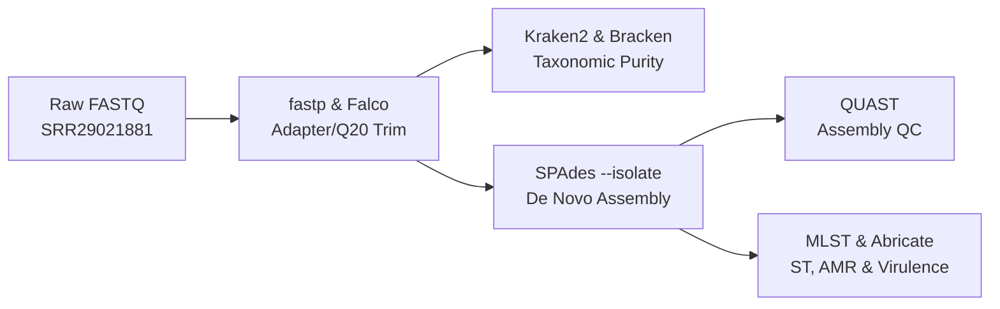

**Research Question:** 

"Does clinical isolate SRR29021881 represent a pure, uncontaminated Niesseria meningitis genome, and what sequence type (ST), antimicrobial resistance (AMR) determinants, and virulence factors define its pathogenic potential?"

